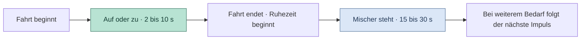

# Mischer-Fahrzeiten und Pausen

Im geregelten Heizbetrieb fährt der Mischer in Impulsen. Liegt der gemessene Vorlauf unter dem Sollwert, öffnet er. Liegt er darüber, schließt er. Innerhalb der Ruhezone von ±0,5 °C stoppt er. Bei größerer Abweichung fährt er länger und wartet anschließend kürzer. Das gilt für beide Fahrtrichtungen.

## Zeitlicher Ablauf



Zeitvergleich mit den Standardwerten. Ein Zeichen entspricht ungefähr einer Sekunde. Die Zeit beginnt mit dem ersten Fahrimpuls.

```text
Abweichung     Fahrt █     Ruhezeit ·                     Nomineller Startabstand*
     2 °C      ██······························                     32 s
     5 °C      ██████·······················                         29 s
   ≥ 8 °C      ██████████···············                             25 s
```

\* Nominelle Zeiten bei gleichbleibender Abweichung und anhaltendem Regelbedarf. Die Firmware prüft den Vorlauf fortlaufend. Bei Eintritt in die Ruhezone, einem Richtungswechsel oder einer Sperre kann ein Impuls früher enden. Der Start hängt außerdem vom Sekundentakt der Ruhezeit und von der Hauptschleife ab.

| Betrag der Abweichung | Fahrzeit bei Standardwerten | Ruhezeit ab Fahrende |
| --- | ---: | ---: |
| Bis einschließlich 0,5 °C | Stopp | Kein neuer Impuls |
| Über 0,5 bis 2 °C | 2 s | 30 s |
| 5 °C | 6 s | 23 s |
| Ab 8 °C | 10 s | 15 s |

Zwischen 2 und 8 °C berechnet die Firmware beide Zeiten aus der Abweichung. Die Fahrzeit wird in Halbschritten, die Ruhezeit in ganzen Sekunden berechnet. Die Restwärmeabfuhr in **Aus** verwendet weiterhin ihre eigene Taktung mit maximal 5 s Fahrzeit und 30 s von Impulsstart zu Impulsstart. Initialisierung und Schließfahrten in Sonderbetriebsarten haben eigene Regeln.

## Einstellung auf der Webseite

In der geschützten **Vorlauf-Kachel** stehen die vier Werte. **Vorlaufeinstellungen speichern** übernimmt sie dauerhaft.

| Werte | Bereich | Standard |
| --- | --- | --- |
| Fahrzeit Minimum und Maximum | 1 bis 10 s in 0,5-s-Schritten | 2 / 10 s |
| Ruhezeit Minimum und Maximum | 5 bis 120 s in ganzen Sekunden | 15 / 30 s |

Das Minimum muss jeweils kleiner oder gleich dem Maximum sein.

## Einstellung und Rückmeldung über MQTT

Sende die Payload als Text mit **Retain aus** an das vorhandene Steuer-Topic `/SmartHome/Keller/Heizung/set`. Bei geändertem Basis-Topic bleibt das Ende `set` gleich. Dezimalwerte verwenden den Punkt. Das Komma trennt Minimum und Maximum.

| Payload-Beispiel | Wirkung | `JDATA.answer` bei Erfolg |
| --- | --- | --- |
| `mischerFahrt:2.5,9.5` | Beide Fahrzeitgrenzen in Sekunden speichern | `h_mischerfahrt` |
| `mischerPause:15,30` | Beide Ruhezeitgrenzen in Sekunden speichern | `h_mischerpause` |
| `restwaermeZieltemperatur:36.5` | Kessel-Zieltemperatur für die Restwärmeabfuhr in **Aus** speichern, 30 bis 40 °C, Standard 35 °C | `h_restwaerme` |

JDATA enthält die gespeicherten Zahlen unter `mischerFahrtMin`, `mischerFahrtMax`, `mischerPauseMin`, `mischerPauseMax` und `restwaermeZieltemperatur`. Die Firmware fordert nach einem dieser Befehle eine Statusmeldung an. Bei ungültigen Werten antwortet sie mit `h_mischerfahrt_invalid`, `h_mischerpause_invalid` oder `h_restwaerme_invalid`. Bei Speicherfehler antwortet sie mit `h_save_error`. Der bisherige Wert bleibt in beiden Fällen aktiv.

`kachelofenAktiv` in JDATA ist ein eigener JSON-Wahrheitswert. `true` entspricht **AKTIV**, `false` entspricht **INAKTIV**. Nach mehr als 21 Minuten ohne gültige Temperaturmeldung wird der Kachelofen als inaktiv geführt. `atRegelung` gibt die gewählte Regelungsart an.

## Node-RED

Für die Fahrzeiten können die beiden Dropdowns ihre Sekundenwerte direkt als Zahlen ausgeben. Nach dem JSON-Parsing aktualisiert JDATA die Anzeige mit `msg.payload.mischerFahrtMin` und `msg.payload.mischerFahrtMax`. Die Dropdowns geben bei einer Bedienung die Topics `MischerFahrtMin` und `MischerFahrtMax` aus. Die Eingangsnachrichten werden in den Dropdowns nur zur Anzeige verwendet. Verbinde die Ausgänge mit **Mischer fahrt set**. Die Function erhält zusätzlich das vollständige JDATA-Objekt für das Wertepaar. Der fertige Text geht an **set heizung**.

Bei den Dropdowns entfallen die Umrechnungen des alten Schiebereglers. Eine Auswahl von **2,5 s** muss als Zahl `2.5` in der Function ankommen. Eine verbliebene Division durch zwei erzeugt `1.25`, das die Fahrzeitprüfung ablehnt.

## Prüfstand

Die Firmware wurde lokal gebaut. Hosttests prüfen Zeitbegrenzung, gültige Einstellungen, MQTT-Befehle und das Verhalten bei Speicherfehlern. Die Prüfung des neuen Firmware-Stands an der Anlage steht aus.
